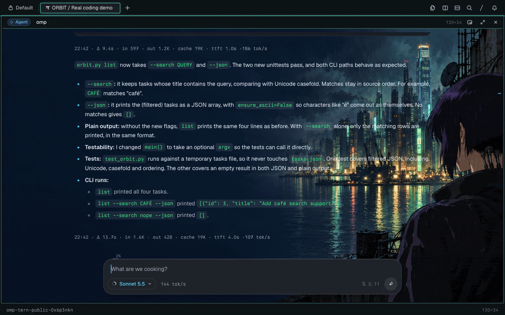
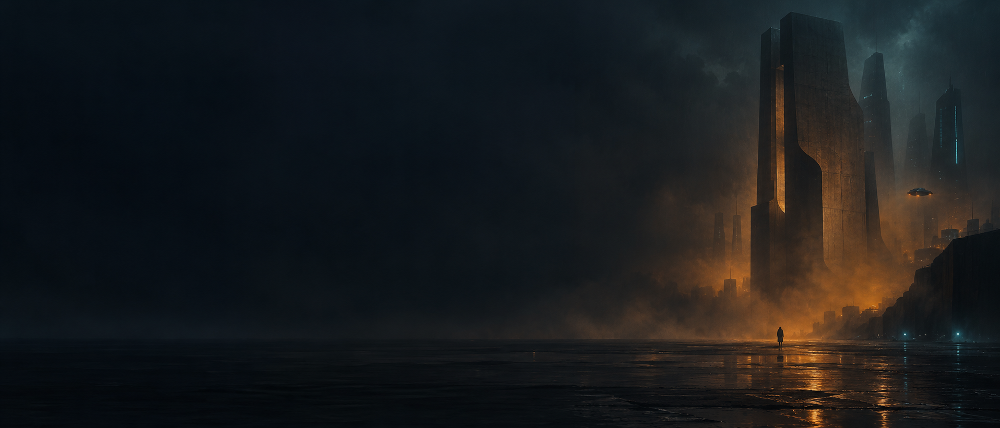
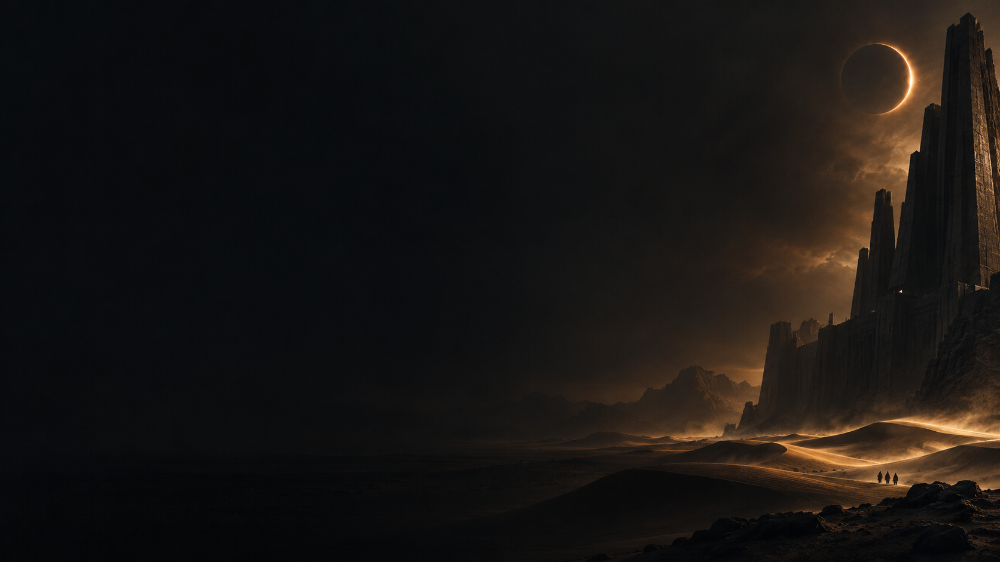
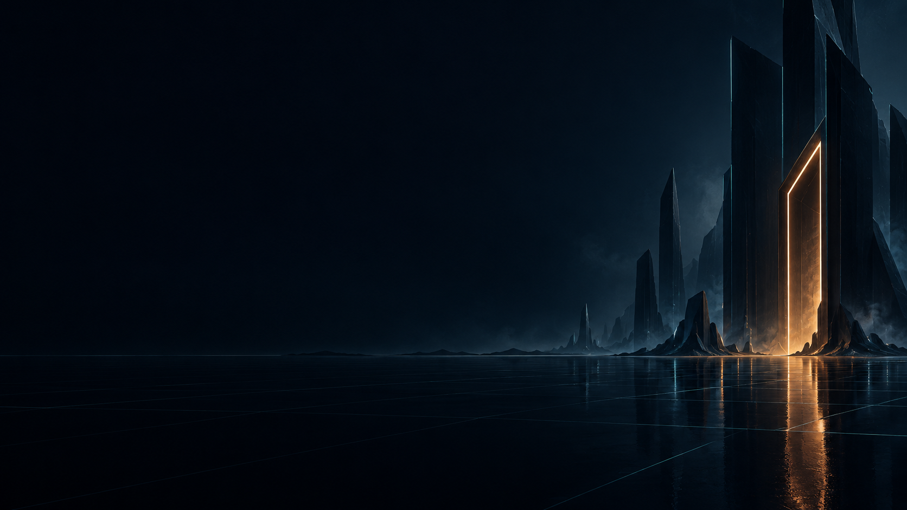
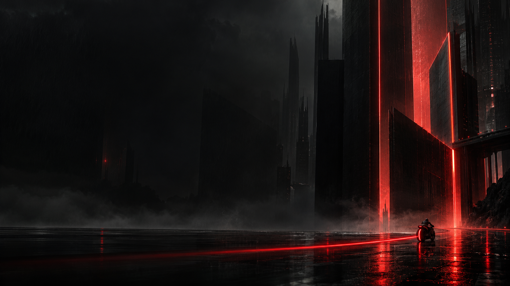
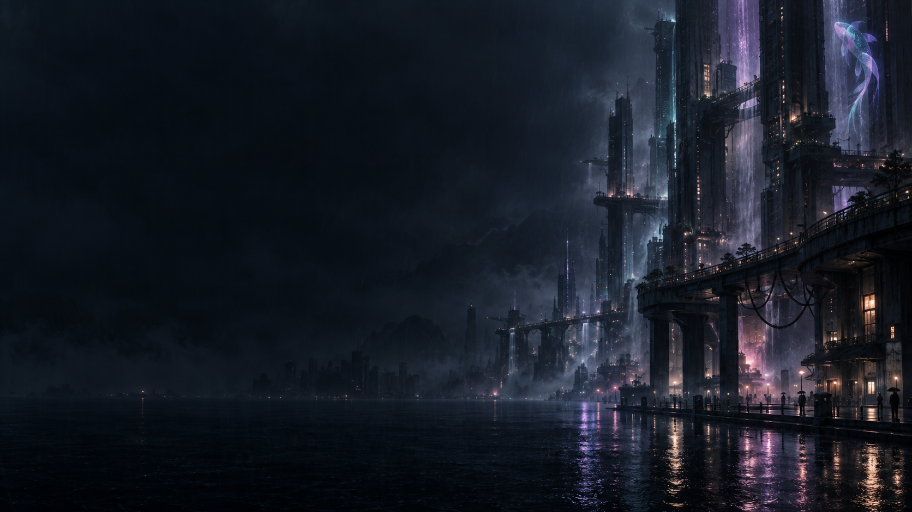
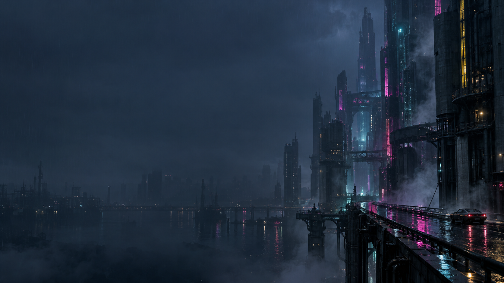
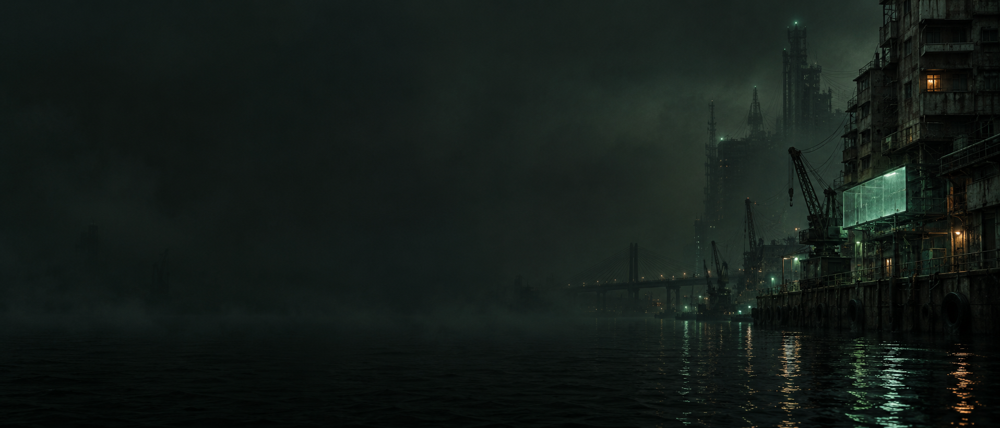
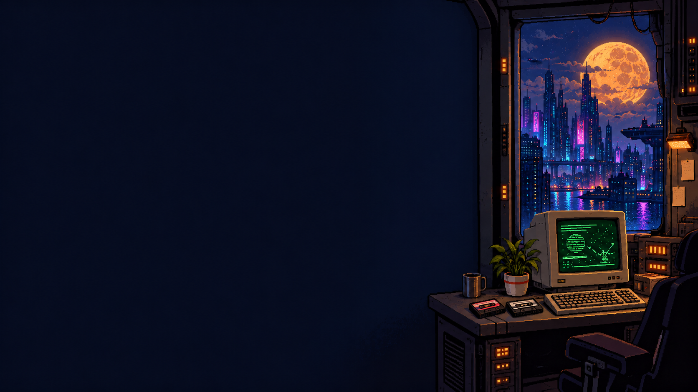

# omp + Tern Config — AI Coding Harness & Terminal Setup

**A ready-to-use setup for native AI coding in omp and Tern: readable terminal presets, parallel agents, real tools and original wallpapers.**

[](https://github.com/Arakiss/omp-tern-config/actions/workflows/check.yml)
[](LICENSE)


[Quick start](#quick-start) · [English demo](#reproduce-the-english-demo) · [Wallpaper CLI](#wallpaper-controls-and-rotation) · [Optional HUD](#optional-retro-future-hud) · [Computer use](docs/computer-use.md) · [Changelog](CHANGELOG.md)

[](assets/demo.mp4)

*A real English coding run, replayed through Tern's native renderer with staged wallpaper changes. Not a performance benchmark. [MP4 video](assets/demo.mp4) · [Static poster](assets/demo-poster.png) · [Original shell preview](assets/preview.png).*

Configuration first: native agent surfaces, parallel workers, real tools, and visible resource usage. **Replicant** is the optional Blade Runner-inspired visual pack, not the project's identity.

This is a portable configuration pack and wallpaper plugin, **not a terminal emulator, a fork, or an official omp/Tern distribution**. Built on [omp](https://github.com/can1357/oh-my-pi) and Tern. Tern's own installation, access requirements and license still apply.

## Why this exists

Keep the coding workflow in omp and Tern's native surfaces instead of layering another terminal or chat wrapper on top. This repository packages the settings, skill and visual plugin so you can reproduce the setup while keeping your own accounts and unrelated configuration.

### What you get

- **Native agent workflow:** model roles, parallel-worker visibility, tool integration and resource usage.
- **Readable terminal defaults:** Titanium styling, solid chrome, contrast correction and native chat.
- **Native integrations:** Tern's attention inbox and optional local CUA computer use with explicit authentication boundaries.
- **Explicit safety boundaries:** preserved approval policy by default, private local backups and no permission bypasses.
- **Optional visual controls:** nine original packs with `tern-bg set`, `next` and `prev`, plus opt-in macOS rotation.
- **Reversible futuristic chrome:** static neon tabs and panel accents with `tern-ui on|off|status`; off by default.

## Quick start

Tested on macOS with **omp 18.10.2, Tern 0.8.3, Apple M4 Pro / 24 GB**. Install omp and Tern separately and ensure `omp`, `tern` and `python3` are on PATH. No Python packages are required.

### 60-second tour

Clone the public [omp-tern-config repository](https://github.com/Arakiss/omp-tern-config), preview the targets, then install:

```sh
git clone https://github.com/Arakiss/omp-tern-config.git
cd omp-tern-config
python3 install.py --dry-run
python3 install.py --wallpaper ghost-shell
export PATH="$HOME/.local/bin:$PATH"
tern-bg list
tern-bg next
tern-bg current
tern-ui status
```

Omit `--wallpaper ghost-shell` to use the default `replicant` pack. From an existing clone, start at the dry-run command.

The installer merges the shipped presets into existing settings, preserves unrelated preferences and custom model roles, backs up settings and any existing wallpaper plugin outside the repository, installs the local wallpaper/HUD plugins and `tern-bg`/`tern-ui` commands, and requests a live reload. A new HUD installation is disabled; reinstalling preserves its existing mode. If live reload fails, reopen Tern. Backups are printed by the installer. A dry run changes no files and installs neither command.

`tern-bg` and `tern-ui` are symlinks at `~/.local/bin/` pointing to this clone's `tern_bg.py` and `tern_ui.py`; unrelated executables at those paths are never overwritten. **Keep the repository available at its installed location**: the commands and rotation need its code and wallpapers. If `~/.local/bin` is not already on PATH, add the `export PATH` line above to your shell configuration, or invoke the commands by their full path. They work from any working directory.

**Wallpaper rotation is opt-in, off by default, and macOS-only.** Installing the pack does not create a periodic schedule. See [wallpaper controls and rotation](#wallpaper-controls-and-rotation) to enable it deliberately.

**Default installation preserves your current approval policy.** For deliberate full agent autonomy:

```sh
python3 install.py --autonomous
```

This sets `tools.approvalMode=yolo` and disables Tern paste confirmations. Agents can then run commands and modify files without harness approval prompts. Only use it in workspaces you trust; it does not bypass macOS permissions, provider safety checks or legal/financial confirmations.

Paths come from `omp config path` and `tern plugin dir`, not a hard-coded username. OMP profiles and Tern's `TERN_CONFIG_DIR` are respected. Run installation with the same profile/environment as the terminal you intend to configure. Keep configuration backups private: they contain your existing preferences.

### Optional CUA computer use

Install [Cua Driver](https://cua.ai/docs/cua-driver) separately, then opt in:

```sh
python3 install.py --cua
```

This merges `omp/mcp-cua.json` into the active omp profile's `mcp.json`, preserving other servers. It uses `cua-driver mcp` over local stdio and CuaDriver's existing macOS app identity, **not** `--direct`, an unauthenticated network listener, or an approval-bypass daemon. Run `/mcp reload` in an already-running omp session, or start a new session.

The tested Cua Driver version is **0.33.4**. Its existing `standard` daemon allows basic observation and input without routine prompts; the installer does not restart it or weaken its security policy. The official skill is optional: `cua-driver skills install`.

Permission status is not a capture test. The integration was exercised through omp's MCP transport with a real `get_window_state` capture, and via the driver with AX observation and a verified native navigation action. See [computer-use setup and verification](docs/computer-use.md).

### Native Tern attention notifications

The installer installs `skills/tern-terminal/SKILL.md` into omp's native skill directory and adds `cmux-terminal` to ignored skills while preserving other ignored entries. Tern notifications use its own waiting/attention inbox, never cmux. The tested attention event appeared as `kind: waiting` in `tern ctl state` → `inbox.entries`.

## What's inside

| Area | Configuration |
| --- | --- |
| Terminal | Titanium dark palette, BerkeleyMono Nerd Font via Tern's bundled default, 14 px terminal text, 13 px UI, +8% line height |
| Readability | Solid chrome, automatic contrast correction, status bar, headers only when split, Reader-style native chat |
| Agent tooling | Image generation, desktop prelude, GitHub and security tooling enabled |
| Delegation | LSP and effort selection for subagents, eight-worker concurrency cap, resolved-model badges and live activity |
| Resource visibility | Token usage, turn time, token rate and error notifications |
| Wallpaper | Local Luau plugin; one image read at load, no plugin timers or network requests; optional macOS LaunchAgent rotation via `tern-bg` |
| Futuristic chrome | Optional native Luau HUD; static cyan/magenta accents, no continuous animation; on/off without preference changes |

Browser automation, persistent Python/JS eval, AST editing, debugging, skills, archive access and compaction are already enabled in the tested omp defaults. This configuration leaves those defaults intact rather than duplicating them. It does not enable remote session broadcasting, automatic credit-reset redemption, background advisors or memory extraction.

### Model roles

| Role | Shipped selector |
| --- | --- |
| Default / planning | `anthropic/claude-opus-5-5` |
| Fast work | `anthropic/claude-sonnet-5-5` |
| Deep analysis | `openai-codex/gpt-6.1-sol:high` |
| Images | `openai-codex/gpt-image-2` |

Use `omp login`, `omp models` and `/model` to connect providers and change roles for your subscriptions. The shipped setup needs Anthropic and OpenAI Codex access; no accounts or tokens are included. Image generation and subagents consume provider quota. Model availability changes independently of this repository.

## Daily controls

These shortcuts come from the tested Tern/omp installation; custom keymaps can change them.

| Action | Shortcut / command |
| --- | --- |
| Tern command palette | `Cmd+K` |
| Split right / down | `Cmd+D` / `Shift+Cmd+D` |
| New tab | `Cmd+T` |
| Find scrollback | `Cmd+F` |
| Files | `Ctrl+Cmd+E` |
| Attention inbox | `Shift+Cmd+I` |
| omp model picker | `Option+P` or `/model` |
| omp agent hub | `Option+A` |
| Inspect panes / program output | `tern ls`, `tern inspect`, `tern capture` |
| Supervised background jobs | `omp ps` |

Tern also exposes native file, browser, Git, SQLite, notebook and canvas blocks. Open them from the command palette. Their capabilities belong to Tern; this pack doesn't replace or duplicate them.

## Wallpaper and customization

Nine original generated images are included. None is a film still, game screenshot or downloaded promotional asset; see [provenance](assets/PROVENANCE.md).

| Pack | Art direction | Preview |
| --- | --- | --- |
| `replicant` | Blade Runner-inspired amber architecture and cyan rain | [](wallpapers/replicant.webp) |
| `dunes` | Dune-inspired desert citadel, basalt and eclipsed sunlight | [](wallpapers/dunes.webp) |
| `grid` | Tron-inspired dark digital architecture, reticle and neon portal | [](wallpapers/grid.webp) |
| `tron-ares` | TRON: Ares-inspired black architecture and scarlet light trails | [](wallpapers/tron-ares.webp) |
| `altered-carbon` | Rainy vertical cyber-noir, violet/teal light and a koi hologram | [](wallpapers/altered-carbon.webp) |
| `cyberpunk` | Retro-anime magenta/cyan kiosk, CRT screens and a red motorbike | [](wallpapers/cyberpunk.webp) |
| `ghost-shell` | 1995 anime-inspired original cyborg investigator and jade harbor | [](wallpapers/ghost-shell.webp) |
| `deus-ex` | Deus Ex-inspired black-and-gold architecture and geometric light | [](wallpapers/deus-ex.webp) |
| `retro-future` | Pixel-art CRT workstation, cassette tapes, neon skyline and amber moon | [](wallpapers/retro-future.webp) |

### Wallpaper controls and rotation

After installation, change only the wallpaper with `tern-bg`. These commands leave omp models and approval policy, MCP, Tern preferences and skills untouched. The installed Tern API reloads native plugins globally; only this pack's wallpaper files are modified. No restart or session close is requested.

| Command | Effect |
| --- | --- |
| `tern-bg list` | List the available packs in rotation order |
| `tern-bg current` | Show the selected pack |
| `tern-bg set cyberpunk` | Apply a named pack |
| `tern-bg next` | Advance one pack, wrapping after `retro-future` |
| `tern-bg prev` | Go back one pack, wrapping before `replicant` |
| `tern-bg rotate --every 15m` | Opt in to a macOS schedule that advances every 15 minutes |
| `tern-bg status` | Show the schedule's configured and loaded state |
| `tern-bg stop` | Remove this project's schedule; leave the current image |

The order is `replicant → dunes → grid → tron-ares → altered-carbon → cyberpunk → ghost-shell → deus-ex → retro-future`, then back to `replicant`. If the command has no saved state, it recognizes the installed image from a previous full installation before advancing.

**Periodic rotation is optional and macOS-only; nothing enables it by default.** To move to the next pack every 15 minutes:

```sh
tern-bg rotate --every 15m
tern-bg status
```

Intervals accept seconds (`s`), minutes (`m`) or hours (`h`), for example `30s`, `15m` or `2h`. Rotation uses a project-owned user LaunchAgent with `StartInterval`, not a persistent polling process. The schedule captures the active `TERN_CONFIG_DIR` when set, so enable it from the environment of the Tern configuration you want to rotate. Manual changes and scheduled advances share state and serialize transitions.

`StartInterval` is a best-effort macOS schedule: sleep, launchd pacing and system load can delay or coalesce ticks. Use it for ambient wallpaper changes, not a frame-accurate animation timer.

Check whether the schedule is configured and loaded, or stop rotation without changing the current image:

```sh
tern-bg status
tern-bg stop
tern-bg status
```

`stop` removes only this project's schedule, not unrelated LaunchAgents. A configured schedule and a loaded job are reported separately; a configured job alone does not mean rotation is running. Wallpaper changes do not create timestamped full-plugin backups on every tick.

`replicant` remains the full install's default, and `python3 install.py --wallpaper PACK` still selects its initial pack while merging the functional presets. Use `tern-bg set PACK` for subsequent visual-only changes. Replace a source WebP with your own image smaller than 8 MiB and run `tern-bg set PACK` to apply it.

The red `tron-ares` pack refers to [Disney's TRON: Ares (2025)](https://movies.disney.com/tron-ares), distinct from the older blue/cyan-inspired `grid` pack. All packs are original interpretations, not official franchise assets.

The stylesheet uses a dark base and a cover crop. Wide displays show more artwork; narrower panes crop it. Cyberpunk, Ghost in the Shell and Retro Future follow the original Replicant/Dunes composition: a calm naturally dark text area and luminous detail on the right, **without a global dimming filter**. The small progress strip has its own opaque backing; native readable editor and tool-card surfaces are retained.

## Optional retro-future HUD

```sh
tern-ui on       # Enable static neon chrome
tern-ui off      # Return to your existing chrome
tern-ui status   # Show the persisted mode
```

The HUD adds cyan tab/pane edges and subtle magenta card accents. It does not change text colors, fonts, input styling, model roles, tools, permissions, approval policy, wallpaper or Tern preferences. There are no continuous effects or animation timers. **Off by default; independent of wallpaper rotation.** Disabling removes only the HUD stylesheet, so no preference snapshot or destructive reset is needed.

The native command palette also exposes **Enable retro-future HUD** and **Disable retro-future HUD**. CLI changes reload Tern's native plugins so open windows use the saved mode; palette actions style the current window immediately, with the saved mode used on reload or subsequent focus events.

## Reproduce the English demo

The animation shows omp adding Unicode case-insensitive search and JSON output to [Orbit](demo/project/orbit.py), then running two real isolated tests and CLI checks. The [vetted native surface trace](demo/orbit.out.jsonl) contains the captured output from that run, not invented tool results. The replay changes Ghost in the Shell, Cyberpunk, Replicant and Dunes backgrounds without recording your desktop or requesting a model.

Install Tern separately. For media tooling on macOS:

```sh
brew install ffmpeg gifsicle
python3 demo/record.py --output /tmp/omp-tern-native.mp4 --hud
python3 demo/encode.py /tmp/omp-tern-native.mp4 \
  --gif assets/demo.gif --video assets/demo.mp4 --optimize-gif --overwrite
```

`--hud` opts into static accents only inside the isolated renderer; omit it for normal chrome. `--overwrite` deliberately replaces this clone's existing demo assets. GIF optimization is optional but reduces size without reducing resolution or frame timing; it uses mild lossy compression. Without `--optimize-gif`, only FFmpeg is required.

The published animation is about 24 seconds at 1280 × 800. The MP4 uses H.264/yuv420p with faststart and no audio; use the smaller video for sharing on X. The GIF loops and samples at a nominal 15 fps. Readable tool results and code remain native Tern surfaces, not a VHS terminal imitation. [Charm VHS](https://github.com/charmbracelet/vhs) is useful for conventional shell/TUI recordings; this example uses Tern's own recorder to retain its actual interface.

Check the example independently:

```sh
python3 -m unittest discover -s demo/project -v
python3 demo/project/orbit.py list --search 'CAFÉ' --json
```


## Privacy and limits

- Only curated presets, plugin code, public assets and a vetted public-example surface trace are shipped. No auth files, private chats, databases, shell history, host lists, email addresses or machine identifiers.
- Existing credentials are never read or copied by the installer. Settings backups stay on your machine.
- Enabling omp's desktop prelude does **not** grant Screen Recording or Accessibility. CuaDriver and Tern have separate macOS permission identities. CUA capture and AX were verified. A fresh native omp session subsequently reported capture/input/AX permissions `granted`, and an exact Tern window capture was saved and inspected. New machines still need their own macOS authorization; neither the installer nor an agent auto-confirms security prompts.
- Installers don't download binaries, install plugins from the network, publish repositories or send posts.
- Disabling approvals is not a sandbox. Review the presets before installation.

## Verification

```sh
python3 -m unittest discover -s tests -v
python3 install.py --dry-run
tern plugin list --json
omp config get task.enableLsp --json
cua-driver doctor --json
cua-driver permissions status --json
```

The initial installation exercised a real `omp --model anthropic/claude-sonnet-5-5 -p --no-session --no-tools` request and returned `OMP_OK`. Tern loaded the wallpaper plugin with status `ready` and no plugin problems; the image was checked in its real renderer, and the active window's computed background and preferences were inspected via `tern ctl`.

## Restore or remove

The installer prints a timestamped backup directory under Tern's configuration directory, inside `omp-tern-config-backups/`. Restore `config.yml` (or `config.yaml`) to the directory from `omp config path`, and `settings.json` to the parent of `tern plugin dir`. If the backup contains `plugin/`, it is the previous wallpaper plugin.

Stop rotation before removing the wallpaper, so a scheduled advance cannot reinstall it:

```sh
tern-bg stop
tern plugin remove omp-tern-config-wallpaper
```

To remove the wallpaper CLI too, remove only the installed `~/.local/bin/tern-bg` symlink. For the separate HUD, run `tern-ui off`, then `tern plugin remove omp-tern-config-hud`, and remove only its `~/.local/bin/tern-ui` symlink. This does not remove your clone, preferences, credentials or backups.

Reopen Tern or run **Reload settings** from its command palette after restoring preferences. Never publish backups.

If a backup contains `mcp.json` or `tern-terminal-SKILL.md`, those are the previous MCP configuration and Tern skill. Restore them to the active omp profile's `mcp.json` and `skills/tern-terminal/SKILL.md`. Keep private backups out of the repository.

## Share

Repository name: **`omp-tern-config`**. Suggested description: **Portable omp AI coding harness and Tern terminal configuration, tools, extensions and optional visual packs.**

A post you can use:

> Tern es la mejor terminal que he probado. Estoy compartiendo omp-tern-config: mi configuración de la terminal Tern y del harness omp, con agentes paralelos, herramientas nativas y fondos originales opcionales. Código abierto, portable y sin credenciales incluidas.

Use https://github.com/Arakiss/omp-tern-config and `assets/preview.png` when publishing. Nothing is automatically sent to GitHub or X.

## License

MIT for the installer, configuration, plugins and contributed documentation. Generated assets are distributed under the same permission grant to the extent applicable rights exist; see provenance. No affiliation with or endorsement by the respective franchises' rights holders, omp, Tern or OpenAI is implied.
