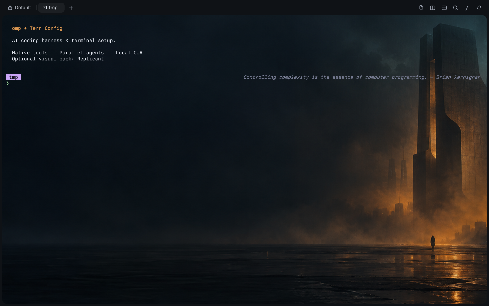

# omp + Tern Config — AI Coding Harness & Terminal Setup

**Portable configuration and extensions for the omp coding harness and Tern terminal.**



Configuration first: native agent surfaces, parallel workers, real tools, and visible resource usage. **Replicant** is the optional Blade Runner-inspired visual pack, not the project's identity.

This is a portable configuration pack and wallpaper plugin, **not a terminal emulator, a fork, or an official omp/Tern distribution**. Built on [omp](https://github.com/can1357/oh-my-pi) and Tern. Tern's own installation, access requirements and license still apply.

## Install

Tested on macOS with **omp 18.10.2, Tern 0.8.3, Apple M4 Pro / 24 GB**. Install omp and Tern separately and ensure `omp`, `tern` and `python3` are on PATH. No Python packages are required.

From a clone of this repository:

```sh
python3 install.py --dry-run
python3 install.py
```

The installer merges the shipped presets into existing settings, preserves unrelated preferences and custom model roles, backs up settings and any existing wallpaper plugin outside the repository, installs the portable image plugin, and requests a live reload. If no window can reload, reopen Tern. Backups are printed by the installer.

**Default installation preserves your current approval policy.** For deliberate full agent autonomy:

```sh
python3 install.py --autonomous
```

This sets `tools.approvalMode=yolo` and disables Tern paste confirmations. Agents can then run commands and modify files without harness approval prompts. Only use it in workspaces you trust; it does not bypass macOS permissions, provider safety checks or legal/financial confirmations.

Paths come from `omp config path` and `tern plugin dir`, not a hard-coded username. OMP profiles and Tern's `TERN_CONFIG_DIR` are respected. Run installation with the same profile/environment as the terminal you intend to configure. Keep configuration backups private: they contain your existing preferences.

### Optional CUA computer use

Install [Cua Driver](https://cua.ai/docs/cua-driver) separately, then opt in:

```sh
python3 install.py --cua
```

This merges `omp/mcp-cua.json` into the active omp profile's `mcp.json`, preserving other servers. It uses `cua-driver mcp` over local stdio and CuaDriver's existing macOS app identity, **not** `--direct`, an unauthenticated network listener, or an approval-bypass daemon. Run `/mcp reload` in an already-running omp session, or start a new session.

The tested Cua Driver version is **0.33.4**. Its existing `standard` daemon allows basic observation and input without routine prompts; the installer does not restart it or weaken its security policy. The official skill is optional: `cua-driver skills install`.

Permission status is not a capture test. The integration was exercised through omp's MCP transport with a real `get_window_state` capture, and via the driver with AX observation and a verified native navigation action. See [computer-use setup and verification](docs/computer-use.md).

### Native Tern attention notifications

The installer installs `skills/tern-terminal/SKILL.md` into omp's native skill directory and adds `cmux-terminal` to ignored skills while preserving other ignored entries. Tern notifications use its own waiting/attention inbox, never cmux. The tested attention event appeared as `kind: waiting` in `tern ctl state` → `inbox.entries`.

## What's inside

| Area | Configuration |
| --- | --- |
| Terminal | Titanium dark palette, BerkeleyMono Nerd Font via Tern's bundled default, 14 px terminal text, 13 px UI, +8% line height |
| Readability | Solid chrome, automatic contrast correction, status bar, headers only when split, Reader-style native chat |
| Agent tooling | Image generation, desktop prelude, GitHub and security tooling enabled |
| Delegation | LSP and effort selection for subagents, eight-worker concurrency cap, resolved-model badges and live activity |
| Resource visibility | Token usage, turn time, token rate and error notifications |
| Wallpaper | Local Luau plugin; one image read at load, no timers, network requests or external processes |

Browser automation, persistent Python/JS eval, AST editing, debugging, skills, archive access and compaction are already enabled in the tested omp defaults. This configuration leaves those defaults intact rather than duplicating them. It does not enable remote session broadcasting, automatic credit-reset redemption, background advisors or memory extraction.

### Model roles

| Role | Shipped selector |
| --- | --- |
| Default / planning | `anthropic/claude-opus-5-5` |
| Fast work | `anthropic/claude-sonnet-5-5` |
| Deep analysis | `openai-codex/gpt-6.1-sol:high` |
| Images | `openai-codex/gpt-image-2` |

Use `omp login`, `omp models` and `/model` to connect providers and change roles for your subscriptions. The shipped setup needs Anthropic and OpenAI Codex access; no accounts or tokens are included. Image generation and subagents consume provider quota. Model availability changes independently of this repository.

## Daily controls

These shortcuts come from the tested Tern/omp installation; custom keymaps can change them.

| Action | Shortcut / command |
| --- | --- |
| Tern command palette | `Cmd+K` |
| Split right / down | `Cmd+D` / `Shift+Cmd+D` |
| New tab | `Cmd+T` |
| Find scrollback | `Cmd+F` |
| Files | `Ctrl+Cmd+E` |
| Attention inbox | `Shift+Cmd+I` |
| omp model picker | `Option+P` or `/model` |
| omp agent hub | `Option+A` |
| Inspect panes / program output | `tern ls`, `tern inspect`, `tern capture` |
| Supervised background jobs | `omp ps` |

Tern also exposes native file, browser, Git, SQLite, notebook and canvas blocks. Open them from the command palette. Their capabilities belong to Tern; this pack doesn't replace or duplicate them.

## Wallpaper and customization

Three original generated images are included. None is a film still or a downloaded promotional asset; see [provenance](assets/PROVENANCE.md).

| Pack | Art direction | Preview |
| --- | --- | --- |
| `replicant` | Blade Runner-inspired amber architecture and cyan rain | [Image](wallpapers/replicant.webp) |
| `dunes` | Dune-inspired desert citadel, basalt and eclipsed sunlight | [Image](wallpapers/dunes.webp) |
| `grid` | Tron-inspired dark digital architecture, reticle and neon portal | [Image](wallpapers/grid.webp) |

Change only the visual pack, without touching models, permissions, preferences, skills or MCP:

```sh
python3 install.py --wallpaper dunes --wallpaper-only
python3 install.py --wallpaper grid --wallpaper-only
python3 install.py --wallpaper replicant --wallpaper-only
```

`replicant` remains the default. A full install also accepts `--wallpaper PACK`; `--wallpaper-only` cannot be combined with `--cua` or `--autonomous`. Replace a source WebP with your own image smaller than 8 MiB and rerun the corresponding command.

The stylesheet uses a dark base and a cover crop. Wide displays show more architecture; narrower panes crop it. The plugin styles pane backgrounds; native editors and tool cards may paint their own opaque surfaces. Those readable surfaces are intentionally retained.

## Privacy and limits

- Only curated preset JSON, plugin code and public assets are shipped. No auth files, chat sessions, databases, shell history, host lists, email addresses or machine identifiers.
- Existing credentials are never read or copied by the installer. Settings backups stay on your machine.
- Enabling omp's desktop prelude does **not** grant Screen Recording or Accessibility. CuaDriver and Tern have separate macOS permission identities. CUA's live capture and AX were verified; a fresh native omp session confirmed Tern's input and AX permissions granted, while native capture was still denied. Adding the missing Screen Recording entry requires the user's administrator authentication. Neither the installer nor an agent auto-confirms those prompts.
- Installers don't download binaries, install plugins from the network, publish repositories or send posts.
- Disabling approvals is not a sandbox. Review the presets before installation.

## Verification

```sh
python3 -m unittest discover -s tests -v
python3 install.py --dry-run
tern plugin list --json
omp config get task.enableLsp --json
cua-driver doctor --json
cua-driver permissions status --json
```

The initial installation exercised a real `omp --model anthropic/claude-sonnet-5-5 -p --no-session --no-tools` request and returned `OMP_OK`. Tern loaded the wallpaper plugin with status `ready` and no plugin problems; the image was checked in its real renderer, and the active window's computed background and preferences were inspected via `tern ctl`. The preview is a styled shell demonstration, not a fabricated agent run.

## Restore or remove

The installer prints a timestamped backup directory under Tern's configuration directory, inside `omp-tern-config-backups/`. Restore `config.yml` (or `config.yaml`) to the directory from `omp config path`, and `settings.json` to the parent of `tern plugin dir`. If the backup contains `plugin/`, it is the previous wallpaper plugin.

To remove only the wallpaper:

```sh
tern plugin remove omp-tern-config-wallpaper
```

Reopen Tern or run **Reload settings** from its command palette after restoring preferences. Never publish backups.

If a backup contains `mcp.json` or `tern-terminal-SKILL.md`, those are the previous MCP configuration and Tern skill. Restore them to the active omp profile's `mcp.json` and `skills/tern-terminal/SKILL.md`. Keep private backups out of the repository.

## Share

Repository name: **`omp-tern-config`**. Suggested description: **Portable omp AI coding harness and Tern terminal configuration, tools, extensions and optional visual packs.**

A post you can use:

> Tern es la mejor terminal que he probado. Estoy compartiendo omp-tern-config: mi configuración de la terminal Tern y del harness omp, con agentes paralelos, herramientas nativas y fondos originales opcionales. Código abierto, portable y sin credenciales incluidas.

Add your repository URL and `assets/preview.png` when publishing. Nothing is automatically sent to GitHub or X.

## License

MIT for the installer, configuration, plugin and contributed documentation. The generated asset is distributed under the same permission grant to the extent applicable rights exist; see provenance. No affiliation with or endorsement by the film's rights holders, omp, Tern or OpenAI is implied.
