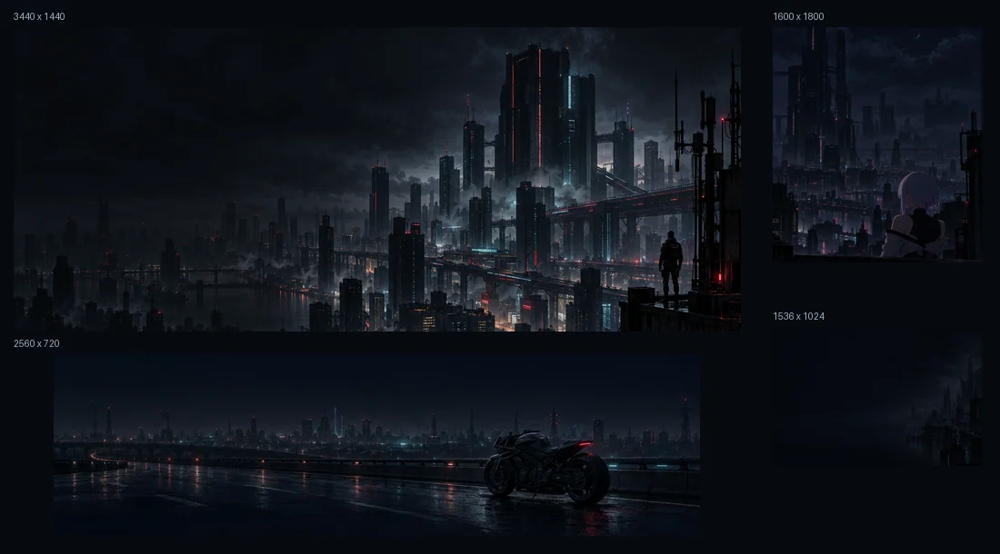
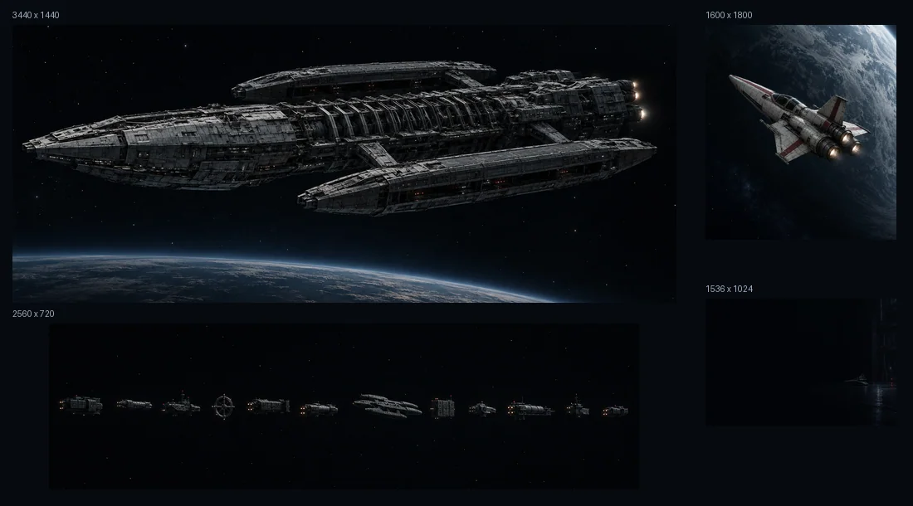
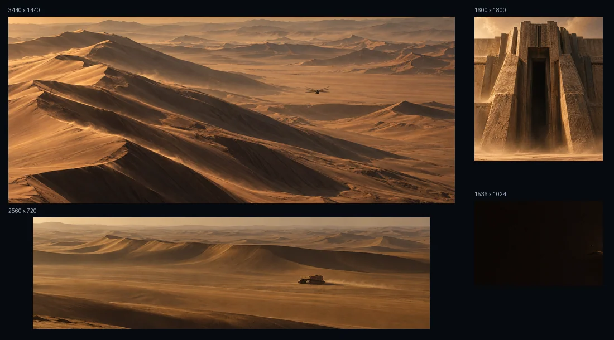
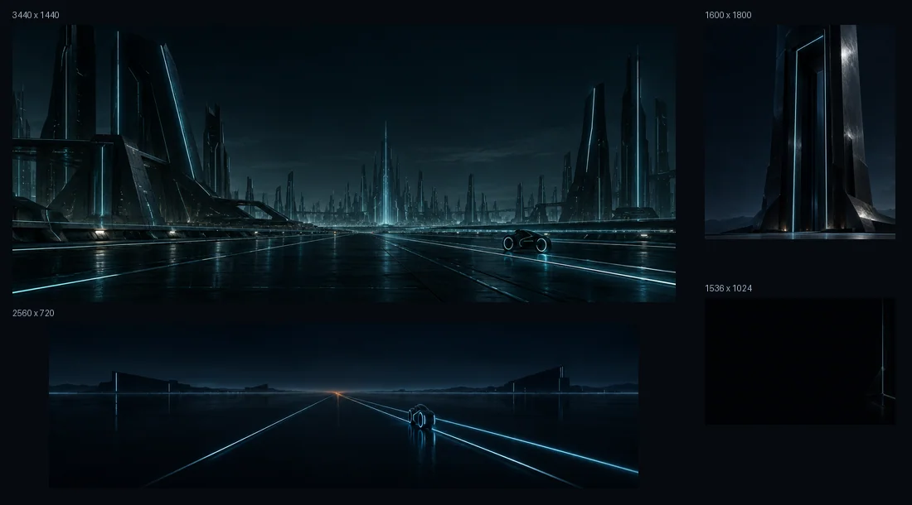
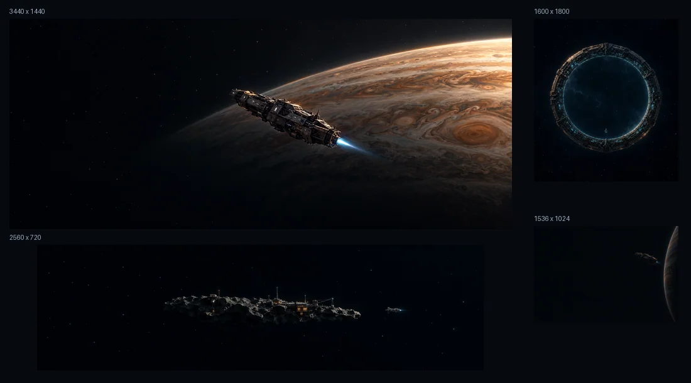
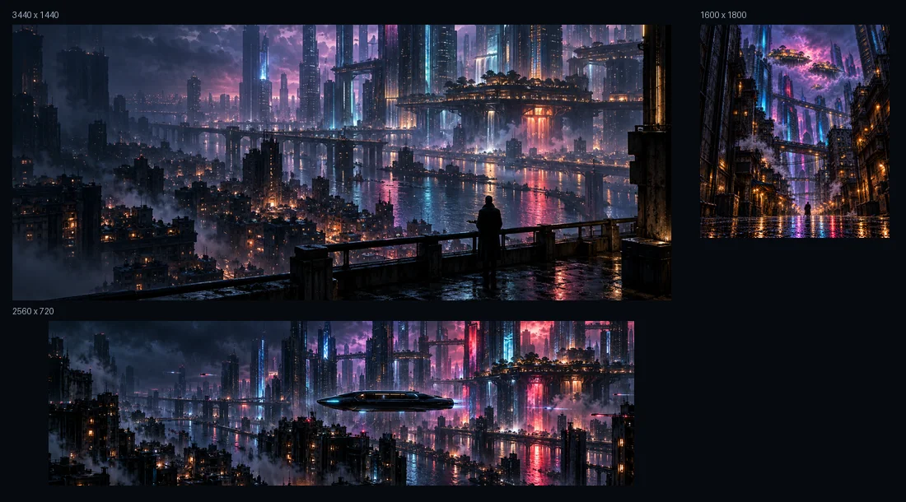
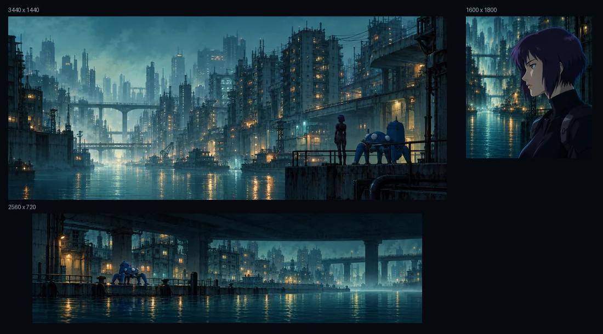
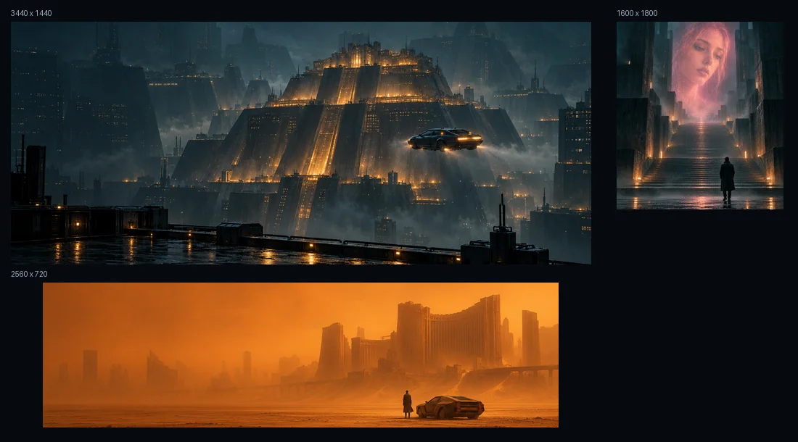
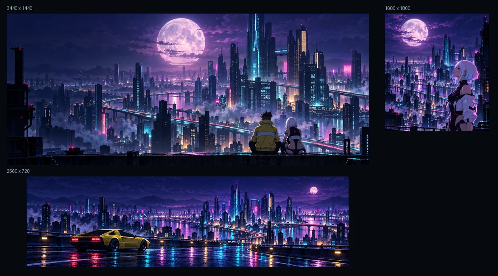

# Desktop and terminal wallpaper collections

Nine collections with 30 desktop wallpapers, including three darker Ghost in the Shell variants. Five dedicated terminal companions join the nine original terminal packs. Generated originals and distinct composition alternatives are retained.

Desktop exports fit 3440 x 1440, 2560 x 720 and 1600 x 1800 displays. Terminal companions are 1536 x 1024. These are encoded export dimensions, not claims of native generation resolution.

Open a full-size file below and download it. The preview images are reduced artwork-only contact sheets. No personal terminal captures are included.

For Tern, use `tern-bg set PACK`, or `python3 tern_bg.py set PACK` from the repository root without a full preset installation. Desktop files are applied separately through your operating system. See [configuration boundaries](../../docs/configuration.md), [technical catalogue](catalog.json) and [provenance and rights](../../assets/PROVENANCE.md).

## Cyberpunk 2077 / Edgerunners (night)

[3440 x 1440](cyberpunk-edgerunners-night/ultragear-3440x1440.png) · [2560 x 720](cyberpunk-edgerunners-night/xeneon-2560x720.png) · [1600 x 1800](cyberpunk-edgerunners-night/sdqhd-1600x1800.png) · [Terminal PNG](cyberpunk-edgerunners-night/terminal.png)

[Generated originals and alternatives](cyberpunk-edgerunners-night/originals/)

Tern pack: `cyberpunk-edgerunners-night`. [Lossless WebP](../cyberpunk-edgerunners-night.webp).

## Battlestar Galactica

[3440 x 1440](battlestar-galactica/ultragear-3440x1440.png) · [2560 x 720](battlestar-galactica/xeneon-2560x720.png) · [1600 x 1800](battlestar-galactica/sdqhd-1600x1800.png) · [Terminal PNG](battlestar-galactica/terminal.png)

[Generated originals and alternatives](battlestar-galactica/originals/)

Tern pack: `battlestar-galactica`. [Lossless WebP](../battlestar-galactica.webp).

## Dune

[3440 x 1440](dune/ultragear-3440x1440.png) · [2560 x 720](dune/xeneon-2560x720.png) · [1600 x 1800](dune/sdqhd-1600x1800.png) · [Terminal PNG](dune/terminal.png)

[Generated originals and alternatives](dune/originals/)

Tern pack: `dune`. [Lossless WebP](../dune.webp).

## TRON: Legacy

[3440 x 1440](tron-legacy/ultragear-3440x1440.png) · [2560 x 720](tron-legacy/xeneon-2560x720.png) · [1600 x 1800](tron-legacy/sdqhd-1600x1800.png) · [Terminal PNG](tron-legacy/terminal.png)

[Generated originals and alternatives](tron-legacy/originals/)

Tern pack: `tron-legacy`. [Lossless WebP](../tron-legacy.webp).

## The Expanse

[3440 x 1440](the-expanse/ultragear-3440x1440.png) · [2560 x 720](the-expanse/xeneon-2560x720.png) · [1600 x 1800](the-expanse/sdqhd-1600x1800.png) · [Terminal PNG](the-expanse/terminal.png)

[Generated originals and alternatives](the-expanse/originals/)

Tern pack: `the-expanse`. [Lossless WebP](../the-expanse.webp).

## Altered Carbon

[3440 x 1440](altered-carbon/ultragear-3440x1440.png) · [2560 x 720](altered-carbon/xeneon-2560x720.png) · [1600 x 1800](altered-carbon/sdqhd-1600x1800.png)

[Generated originals and alternatives](altered-carbon/originals/)

## Ghost in the Shell

[3440 x 1440](ghost-in-the-shell/ultragear-3440x1440.png) · [2560 x 720](ghost-in-the-shell/xeneon-2560x720.png) · [1600 x 1800](ghost-in-the-shell/sdqhd-1600x1800.png) · [3440 x 1440 (darker)](ghost-in-the-shell/night/ultragear-3440x1440.png) · [2560 x 720 (darker)](ghost-in-the-shell/night/xeneon-2560x720.png) · [1600 x 1800 (darker)](ghost-in-the-shell/night/sdqhd-1600x1800.png)

[Generated originals and alternatives](ghost-in-the-shell/originals/)

## Blade Runner

[3440 x 1440](blade-runner/ultragear-3440x1440.png) · [2560 x 720](blade-runner/xeneon-2560x720.png) · [1600 x 1800](blade-runner/sdqhd-1600x1800.png)

[Generated originals and alternatives](blade-runner/originals/)

## Cyberpunk: Edgerunners (original set)

[3440 x 1440](edgerunners/ultragear-3440x1440.png) · [2560 x 720](edgerunners/xeneon-2560x720.png) · [1600 x 1800](edgerunners/sdqhd-1600x1800.png)

[Generated originals and alternatives](edgerunners/originals/)

## Publication notes

The catalogue records SHA-256 hashes, exact encoded dimensions and available generation/processing evidence. Byte-identical per-monitor and installed-terminal mirrors are represented by references rather than duplicate files. Source/finished versions and genuinely different alternatives remain separate.

These are unofficial generated fan-art interpretations, including recognizable fictional characters and designs. Underlying franchise rights remain with their owners. The repository permission grant applies only to rights contributors can grant; no affiliation or endorsement is implied.

Local backups, QA images, personal photos, session data and legacy JPEGs without verified provenance are outside this selection.
